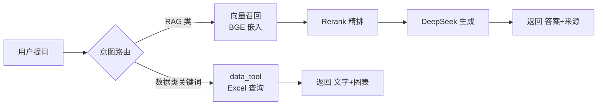

# RAG 知识库（企业知识问答 + 数据分析）

> 制度文档问答 + Excel 数据查询，带来源引用和自动图表。

## 背景

面向 PCB 投料/余数管理场景，解决两类问题：一是制度文档（管控红线、编码规则、工艺对照表）的「问得到、答得准」；二是历史报废率等结构化数据的「查得了、看得懂」。服务对象为业务/稽查人员，答案必须可溯源、不编造。

## 核心能力

- 制度文档 RAG 问答（Chroma + BGE 嵌入，答案附来源引用）
- 两阶段检索 + Rerank 精排（BGE 向量召回 Top-10 → bge-reranker-v2-m3 精排输出 Top-4）
- Excel 结构化数据查询 + 自动出图（按工厂/表面处理/层数/工艺类型分组）
- 多轮对话 + Query Rewriting（指代消解）
- RAGAS 量化评估：Faithfulness 1.00 / ContextPrecision 0.93 / AnswerRelevancy 0.87
- Docker Compose 双服务编排（FastAPI + Streamlit）

## 技术栈

| 层 | 技术 |
|---|---|
| 语言 | Python 3.14 |
| 框架 | LangChain 1.x |
| 向量库 | Chroma（本地持久化） |
| 嵌入 | BAAI/bge-small-zh-v1.5 |
| 重排序 | BAAI/bge-reranker-v2-m3 |
| 大模型 | DeepSeek API（OpenAI 兼容接口） |
| 检索服务 | FastAPI |
| 前端 | Streamlit |
| 容器化 | Docker + docker-compose |

## 架构



## 快速开始

### 本地运行

```bash
# 1. 环境准备
python -m venv .venv
.\.venv\Scripts\Activate.ps1          # PowerShell（cmd 用 activate.bat）
pip install torch --index-url https://download.pytorch.org/whl/cpu   # 先装 CPU 版 torch
pip install -r requirements.txt

# 2. 配置 .env
copy .env.example .env                # 填入 DEEPSEEK_API_KEY

# 3. 灌库（首次/更新知识文档后）
python ingest.py

# 4. 启动 Streamlit
streamlit run app.py

# 5. 启动 API（可选，供其他系统调用）
python api.py
```

### Docker 运行

```bash
docker compose up -d
```

| 服务 | 地址 |
|---|---|
| FastAPI 检索服务 | http://localhost:8000 |
| Streamlit 问答界面 | http://localhost:8501 |

## 项目结构

```
RAG知识库/
├── api.py               # FastAPI 检索服务
├── app.py               # Streamlit 问答界面
├── ingest.py            # 灌库脚本
├── config.py            # 配置中心（统一 getter + 校验）
├── config/
│   └── dimensions.yaml  # 可分组维度配置（加维度不改代码）
├── knowledge/           # 知识源 Markdown（9 个主题）
├── data/                # 业务数据（gitignore，不提交）
├── docs/                # 架构/评估/部署/踩坑文档
├── scripts/
│   └── evaluate_ragas.py  # RAGAS 评估入口
├── src/
│   ├── retriever.py     # 两阶段检索（向量 + Rerank）
│   ├── embeddings.py    # BGE 嵌入封装
│   ├── reranker.py      # Rerank 模型封装
│   ├── qa_chain.py      # 意图路由 + 问答链路
│   ├── data_tool.py     # Excel 查询与图表
│   ├── llm_client.py    # DeepSeek 调用客户端
│   ├── loader.py        # 文档加载与切片
│   └── request_logger.py # API 请求日志（SQLite）
└── tests/               # 单元测试
```

## 核心设计

1. **两阶段检索 + Rerank**：先 BGE 向量召回 Top-N 候选，再用交叉编码器精排到 Top-k，兼顾召回与精度；Rerank 模型加载失败自动降级为纯向量检索，不中断服务。

2. **Query Rewriting**：多轮对话中「那第二条呢」这类指代性提问，先用历史把 query 补全成独立检索语句，再进向量库，解决指代导致的召回不准；单轮不触发，零额外成本。

3. **维度配置化**：`dimensions.yaml` 定义可分组维度（表面处理/层数/工艺类型等）的列名、触发关键词、label 映射。新增维度只需加配置，无需改 `data_tool.py` 路由代码。

4. **RAGAS 评估闭环**：接入量化评估后，真实发现了「编码含义解释」被误判为「数据查询」的路由 bug（`物料编码 XXX 第几位是什么` 返回未找到），修复后三个指标全面回升。

5. **Docker 同步预加载模型**：容器启动时同步加载 embedding + Rerank 模型，避免首次 `/retrieve` 因模型未就绪而超时降级；代价是启动慢约 10-30 秒，换来启动后所有请求都走完整链路。

## 测试

```bash
python -m unittest discover -s tests
```

当前 50 个测试全部通过，覆盖意图路由、多轮历史裁剪、Query Rewriting、Rerank 降级、数据查询等。

## 注意事项

- 本仓库**不含真实业务数据**（`data/`、`chroma_db/`、`static/`、`logs/` 均已 gitignore）。
- 首次启动需下载 BGE 模型（约 95MB）+ Rerank 模型（约 1.2GB）。
- 需配置 `DEEPSEEK_API_KEY`（`.env`，勿提交）。
- 详细说明见 `docs/` 下的架构、评估、部署、踩坑文档。
