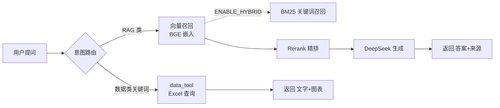

# RAG 知识库（企业知识问答 + 数据分析）

> 制度文档问答 + Excel 数据查询，带来源引用和自动图表。

## 背景

面向 PCB 投料/余数管理场景，解决两类问题：一是制度文档（管控红线、编码规则、工艺对照表）的「问得到、答得准」；二是历史报废率等结构化数据的「查得了、看得懂」。服务对象为业务/稽查人员，答案必须可溯源、不编造。

## 核心能力

- 制度文档 RAG 问答（Chroma + BGE 嵌入，答案附来源引用）
- 两阶段检索 + Rerank 精排（BGE 向量召回 Top-10 → bge-reranker-v2-m3 精排输出 Top-4）
- 知识库版本管理 + 增量 upsert：确定性 `chunk_id` + `version`/`deprecated` 元数据；按文件哈希只重灌变化文件；旧块标 `deprecated` 软删除可回滚
- 混合检索（BM25 + 向量 + RRF）：`src/bm25.py` + `rrf_fusion` + `hybrid_search`，开关 `ENABLE_HYBRID` 默认关（当前小库无额外增益，为规模化预留）
- 无标题长文档切分降级：`_is_headerless` 显式分支，「标题 → 段落标点 → 固定长度+滑动窗口」三级阶梯
- Excel 结构化数据查询 + 自动出图（按工厂/表面处理/层数/工艺类型分组）
- 多轮对话 + Query Rewriting（指代消解）
- RAGAS 量化评估：Faithfulness 1.00 / ContextPrecision 0.93 / AnswerRelevancy 0.87
- Docker Compose 双服务编排（FastAPI + Streamlit）

## 技术栈

| 层 | 技术 |
|---|---|
| 语言 | Python 3.14 |
| 框架 | LangChain 1.x |
| 向量库 | Chroma（本地持久化） |
| 嵌入 | BAAI/bge-small-zh-v1.5 |
| 重排序 | BAAI/bge-reranker-v2-m3 |
| 关键词检索 | rank-bm25 + jieba（混合检索，默认关） |
| 大模型 | DeepSeek API（OpenAI 兼容接口） |
| 检索服务 | FastAPI |
| 前端 | Streamlit |
| 容器化 | Docker + docker-compose |

## 架构



> 虚线为可选混合检索路径，`ENABLE_HYBRID` 默认关。

## 快速开始

### 本地运行

```bash
# 1. 环境准备
python -m venv .venv
.\.venv\Scripts\Activate.ps1          # PowerShell（cmd 用 activate.bat）
pip install torch --index-url https://download.pytorch.org/whl/cpu   # 先装 CPU 版 torch
pip install -r requirements.txt

# 2. 配置 .env
copy .env.example .env                # 填入 DEEPSEEK_API_KEY

# 3. 灌库（首次/更新知识文档后；默认增量，只重灌变化文件）
python ingest.py            # 增量
python ingest.py --full     # 全量重建

# 4. 启动 Streamlit
streamlit run app.py

# 5. 启动 API（可选，供其他系统调用）
python api.py
```

### Docker 运行

```bash
docker compose up -d
```

| 服务 | 地址 |
|---|---|
| FastAPI 检索服务 | http://localhost:8000 |
| Streamlit 问答界面 | http://localhost:8501 |

## 项目结构

```
RAG知识库/
├── api.py               # FastAPI 检索服务
├── app.py               # Streamlit 问答界面
├── ingest.py            # 灌库脚本（默认增量 upsert，--full 全量重建）
├── config.py            # 配置中心（统一 getter + 校验）
├── config/
│   └── dimensions.yaml  # 可分组维度配置（加维度不改代码）
├── knowledge/           # 知识源 Markdown（9 个主题）
├── data/                # 业务数据（gitignore，不提交）
├── docs/                # 架构/评估/部署/踩坑文档
├── scripts/
│   └── evaluate_ragas.py  # RAGAS 评估入口
├── src/
│   ├── retriever.py     # 两阶段检索（向量 + Rerank）+ hybrid_search + rrf_fusion
│   ├── bm25.py          # BM25 关键词召回（混合检索稀疏召回一路）
│   ├── embeddings.py    # BGE 嵌入封装
│   ├── reranker.py      # Rerank 模型封装
│   ├── qa_chain.py      # 意图路由 + 问答链路
│   ├── data_tool.py     # Excel 查询与图表
│   ├── llm_client.py    # DeepSeek 调用客户端
│   ├── loader.py        # 文档加载与切片（标题优先 + 无标题降级）
│   └── request_logger.py # API 请求日志（SQLite）
└── tests/               # 单元测试（pytest）
```

## 核心设计

1. **两阶段检索 + Rerank**：先 BGE 向量召回 Top-N 候选，再用交叉编码器精排到 Top-k，兼顾召回与精度；Rerank 模型加载失败自动降级为纯向量检索，不中断服务。

2. **知识库版本管理 + 增量 upsert**：切块带内容寻址的确定性 `chunk_id` + `version`/`deprecated`/`file_hash` 元数据；`ingest.py` 按源文件哈希只重灌变化文件、`store.upsert` 就地更新；旧块标 `deprecated=True` 软删除、检索 `filter={"deprecated": False}` 过滤，改回文件再增量一次即回滚。

3. **混合检索（BM25 + RRF，默认关）**：`src/bm25.py` 从向量库同一批 chunk 建 BM25 索引（jieba 分词），`retriever.hybrid_search` 双路召回后用 `rrf_fusion(k=60)` 融合去重再 Rerank。`ENABLE_HYBRID` 默认关——实测当前 9 篇 34 chunk + 开 Rerank 时纯向量已召回专有名词表、混合无额外增益，是规模化预留。

4. **无标题长文档切分降级**：标题优先（`##` 当语义边界）→ 无标题/超长走「段落 → 中文句读 → 固定长度+滑动窗口」阶梯，`_is_headerless` 显式分支；语义切分/LLM 切分只在话术里提、不实现。

5. **Query Rewriting**：多轮对话中「那第二条呢」这类指代性提问，先用历史把 query 补全成独立检索语句，再进向量库，解决指代导致的召回不准；单轮不触发，零额外成本。

6. **维度配置化**：`dimensions.yaml` 定义可分组维度（表面处理/层数/工艺类型等）的列名、触发关键词、label 映射。新增维度只需加配置，无需改 `data_tool.py` 路由代码。

7. **RAGAS 评估闭环**：接入量化评估后，真实发现了「编码含义解释」被误判为「数据查询」的路由 bug（`物料编码 XXX 第几位是什么` 返回未找到），修复后三个指标全面回升。

8. **Docker 同步预加载模型**：容器启动时同步加载 embedding + Rerank 模型，避免首次 `/retrieve` 因模型未就绪而超时降级；代价是启动慢约 10-30 秒，换来启动后所有请求都走完整链路。

## 测试

```bash
PYTHONIOENCODING=utf-8 python -m pytest tests/ -q
```

当前 62 个测试全部通过，覆盖意图路由、多轮历史裁剪、Query Rewriting、Rerank 降级、增量灌库、切分降级、deprecated 过滤、RRF 融合、数据查询等。

## 已知边界

- **RAGAS 评估集仅 15 条（小样本）**：三个指标好看有小样本红利，未按问题类型分桶扩容。
- **`hybrid_search` 未接入 `qa_chain`**：目前是独立函数，`ENABLE_HYBRID` 默认关且 `qa_chain._route_rag` 仍调 `search()`，要生产生效需接线（待办）。
- **9 篇文档无 frontmatter，`version` 全为 "1.0"**：版本元数据是预留机制，当前未真正启用（改文档时通过 `file_hash` 判变化、不靠 version）。

## 注意事项

- 本仓库**不含真实业务数据**（`data/`、`chroma_db/`、`static/`、`logs/` 均已 gitignore）。
- 首次启动需下载 BGE 模型（约 95MB）+ Rerank 模型（约 1.2GB）。
- 需配置 `DEEPSEEK_API_KEY`（`.env`，勿提交）。
- 详细说明见 `docs/` 下的架构、评估、部署、踩坑文档。
